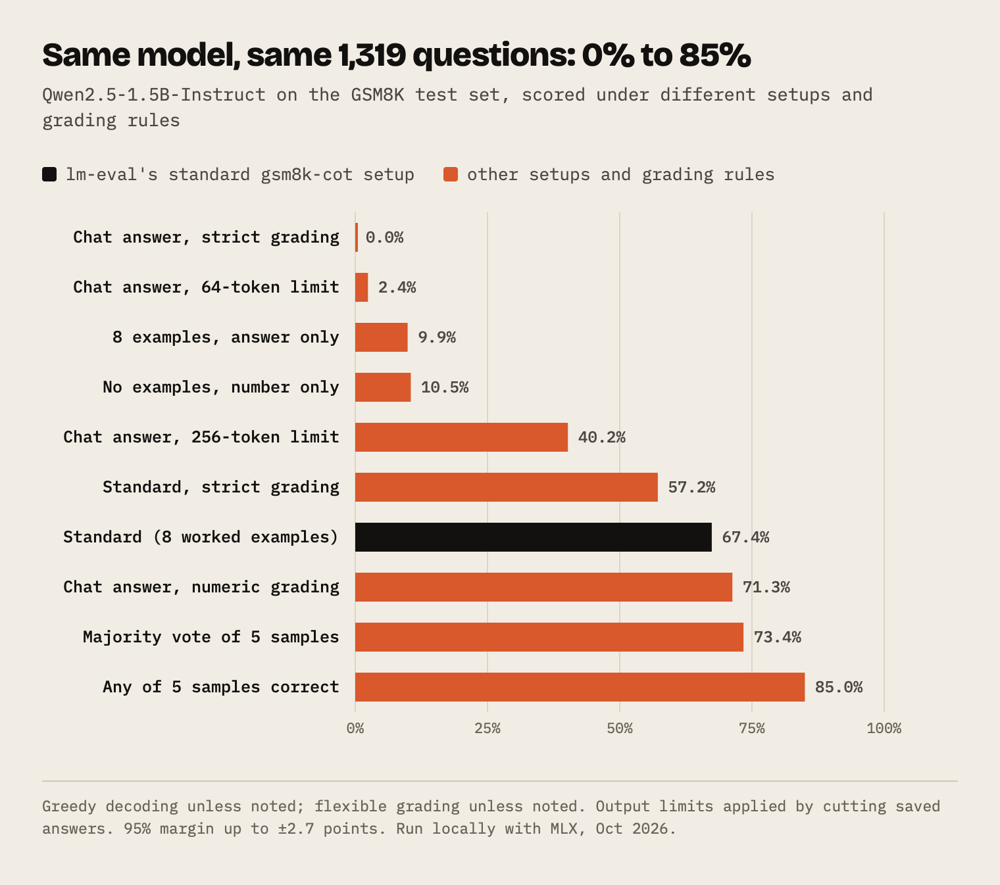
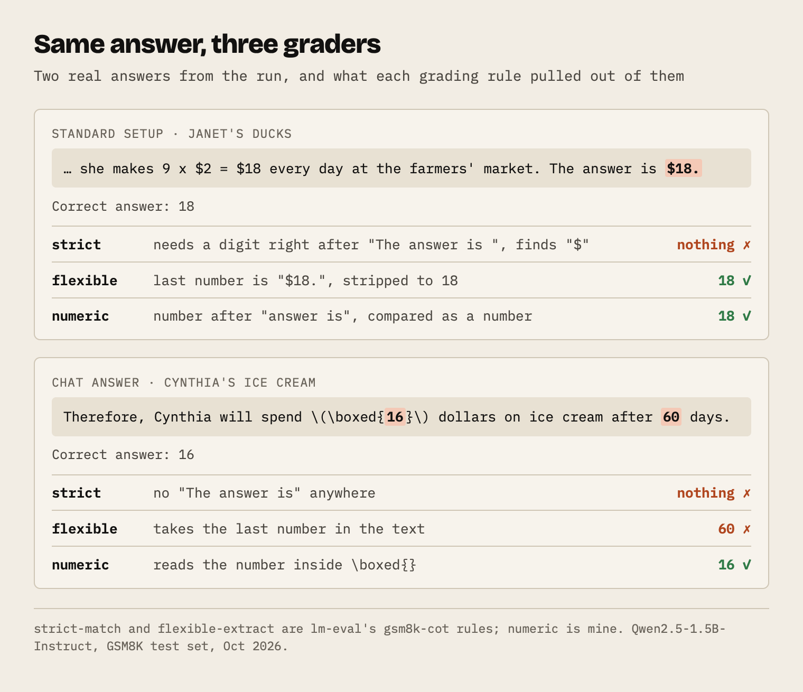
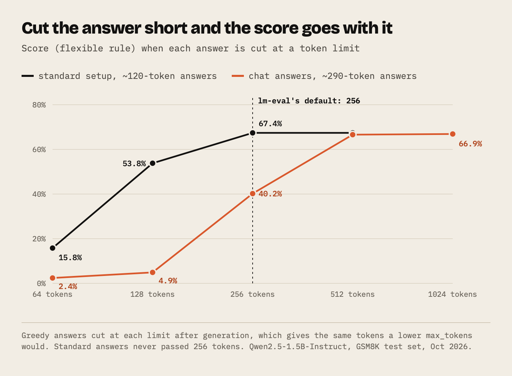

Here is the first question in the GSM8K test set:

> Janet's ducks lay 16 eggs per day. She eats three for breakfast every morning and bakes muffins for her friends every day with four. She sells the remainder at the farmers' market daily for $2 per fresh duck egg. How much in dollars does she make every day at the farmers' market?

The answer is 18. I asked Qwen2.5-1.5B-Instruct this question with the standard benchmark setup, and it wrote this:

```
Janet's ducks lay 16 eggs per day. She eats 3 for breakfast, so she has
16 - 3 = 13 eggs left. She bakes muffins for her friends with 4 eggs, so
she has 13 - 4 = 9 eggs left. She sells the remaining eggs for $2 each, so
she makes 9 x $2 = $18 every day at the farmers' market. The answer is $18.
```

That's right. lm-eval grades it two ways: one marks it correct, the other marks it wrong, because of the dollar sign.

lm-eval is short for EleutherAI's lm-evaluation-harness, an open-source program that runs a model through a benchmark and grades its answers. Hugging Face's Open LLM Leaderboard was built on it.

I built an agent that writes end-to-end tests: you give it the steps of a test case, and it writes the automation spec. In August I started working out how to benchmark it, and before trusting any score I wrote down where I thought benchmark numbers go wrong. My notes have lines like these:

> If the model answers 72 clips or $72 or seventy-two, does your parser catch it?

> Cap max_tokens too low and the model gets cut off mid-reasoning … it's a config failure that looks identical in the score.

> A model at 92% maj@8 might be 85% pass@1.

I had written all of that without ever seeing it happen. So I ran one small model on the whole GSM8K test set six different ways, on my laptop, and graded every answer three ways. The dollar sign, the cut-off answers and the voting gap all showed up, and on one set of answers lm-eval's own two rules gave 0% and 67%.

## The setup

GSM8K is OpenAI's set of grade-school math word problems ([Cobbe et al., 2021](https://arxiv.org/abs/2110.14168)). The test split has 1,319 questions, each needing a few steps of arithmetic, and each reference answer ends with `#### <number>`. It has been on almost every model launch table for years.

I used [Qwen2.5-1.5B-Instruct](https://huggingface.co/Qwen/Qwen2.5-1.5B-Instruct), small enough to run all of this on my laptop with Apple's MLX library. The whole thing took about two and a half hours. The model weights never changed. Only these did:

- whether the prompt included worked examples ("shots")
- whether the model reasoned step by step or answered straight away
- a plain text prompt or the model's chat format
- how many tokens it was allowed to write
- one greedy answer, or five sampled answers
- the rule that pulls the final number out of the answer

For the standard setup I copied lm-eval's `gsm8k-cot` task exactly: the same eight worked examples, the same `Q: … A:` format, greedy decoding, and a stop at the next `Q:` ([task config at the commit I used](https://github.com/EleutherAI/lm-evaluation-harness/blob/b733598568fde3afa0e008892f8e7bb18cd472b6/lm_eval/tasks/gsm8k/gsm8k-cot.yaml)).

## Six setups, three graders



| Setup | strict | flexible | numeric |
|---|---|---|---|
| No examples, "respond with only the final answer" | 0.0% | 10.5% | 10.8% |
| 8 examples, answer only | 11.0% | 9.9% | 11.4% |
| 8 worked examples, step by step (lm-eval's standard) | 57.2% | 67.4% | 68.8% |
| Same, in the model's chat format | 41.2% | 63.9% | 66.0% |
| No examples, the model's own chat answer | 0.0% | 66.9% | 71.3% |

`strict` and `flexible` are lm-eval's two grading rules; `numeric` is mine, explained below. The sixth setup, five sampled answers per question, has its own section. Differences under about 3 points are noise.

## Asking for the answer only drops it to 10%

Without room to work, the model guesses. Asked for only the number, it answered Janet's question with `24`. With eight examples that each go straight to "The answer is N.", it wrote `The answer is 16.` Both setups landed at about 10%.

Letting it write its working first took the same model from 10% to 67%. The chain-of-thought paper found the same jump on a much bigger model, PaLM 540B ([Wei et al., 2022](https://arxiv.org/abs/2201.11903), Table 2), and a follow-up puts PaLM anywhere from 12.5% to 74.4% depending on examples and voting ([Kojima et al., 2022](https://arxiv.org/abs/2205.11916), Table 25).

## The grading rule is worth 10 points, or all of them

lm-eval reports two numbers for `gsm8k-cot`, both from the same outputs:

- `strict-match` looks for the exact phrase `The answer is (\-?[0-9\.\,]+).` ([line 49](https://github.com/EleutherAI/lm-evaluation-harness/blob/b733598568fde3afa0e008892f8e7bb18cd472b6/lm_eval/tasks/gsm8k/gsm8k-cot.yaml#L49)).
- `flexible-extract` takes the last number anywhere in the output ([lines 54–55](https://github.com/EleutherAI/lm-evaluation-harness/blob/b733598568fde3afa0e008892f8e7bb18cd472b6/lm_eval/tasks/gsm8k/gsm8k-cot.yaml#L54-L55)).

On the standard setup, strict scored 10 points below flexible. I went through the 135 answers that flexible accepted and strict rejected, and 121 of them had a dollar sign, like `The answer is $18.` The strict regex wants a digit straight after "is ". I'm not the first to see this: an lm-eval issue about Qwen2-7B lists dollar-sign answers among its strict misses ([#2707](https://github.com/EleutherAI/lm-evaluation-harness/issues/2707)). Most of the rest never used the phrase at all. Two hit a different bug in the same regex: its final `.` is unescaped, so it matches any character, and when the number isn't followed by a full stop it swallows the last digit. `The answer is 160` was read as 16, and `The answer is 350` as 35. A fix for that is an open pull request ([#4373](https://github.com/EleutherAI/lm-evaluation-harness/pull/4373)).

Flexible has its own blind spots. It compares text after stripping commas, dollar signs and a trailing full stop, so `16.00` doesn't equal `16`. Its regex also accepts runs with no digit in them, like `$.` or `...`, which can replace the real answer; that was reported this month ([#4375](https://github.com/EleutherAI/lm-evaluation-harness/issues/4375)). And because it takes the last number, it grades whatever number happens to come last. For one question the model answered:

```
Therefore, Cynthia will spend \(\boxed{16}\) dollars on ice cream after 60 days.
```

The answer is 16. Flexible read 60. A comment on that same Qwen2-7B issue shows another model getting caught this way: "Fred must deliver 160 red roses by 5 pm" was graded as 5.

So I wrote a third rule, `numeric`: take the number in `\boxed{}` if there is one, else the number after "answer is", else the last number, and compare it as a number. It's closer to what a teacher would accept.



The gap is biggest when you let the model answer in its own style. Asked in its chat format with no examples, Qwen works through the steps and ends with `\boxed{18}`, almost never with "The answer is". On those answers strict gave 0%, flexible 67% and numeric 71%, the best single-answer score in the whole experiment. Someone reported the same split for Qwen2.5-Math-7B-Instruct last year ([#3150](https://github.com/EleutherAI/lm-evaluation-harness/issues/3150)).

This has happened at leaderboard scale. Hugging Face pulled DROP from the Open LLM Leaderboard after finding its answer normalization marked correct answers wrong: a number followed by a newline instead of a space never matched, and a full stop used as a stop token cut `12.25` down to `12` ([Hugging Face, 2023](https://huggingface.co/blog/open-llm-leaderboard-drop)). Earlier that year they found three MMLU implementations giving LLaMA-65B scores 15 points apart, and ranking Falcon-40B above or below it depending on which one you used ([Hugging Face, 2023](https://huggingface.co/blog/open-llm-leaderboard-mmlu)).

## The chat template changed how it answered

Putting the same eight worked examples into the model's chat format, as alternating user and assistant turns, barely moved flexible but cut strict by 16 points. In plain text, the model copied the examples' habit of ending with "The answer is N." In chat format it drifted back to its own style, and most of the answers strict rejected never used the phrase.

lm-eval has an option for exactly this (`--apply_chat_template`), and whether a reported score used it is rarely in the table.

## An output limit of 256 tokens costs chat answers 27 points

Greedy decoding writes the same tokens no matter where you stop it, so I cut the saved answers at different lengths to see what a lower `max_tokens` would have done.

The standard answers are short, about 120 tokens on average. The chat-style answers run to about 290, with LaTeX and numbered steps.



| Output limit | Standard setup (flexible) | Chat answers (flexible) |
|---|---|---|
| 64 tokens | 15.8% | 2.4% |
| 128 tokens | 53.8% | 4.9% |
| 256 tokens | 67.4% | 40.2% |
| 512 tokens | 67.4% | 66.6% |

256 is the default output limit in lm-eval's Hugging Face backend ([`huggingface.py`, line 476](https://github.com/EleutherAI/lm-evaluation-harness/blob/b733598568fde3afa0e008892f8e7bb18cd472b6/lm_eval/models/huggingface.py#L476)). It's plenty for the short standard answers and costs the chat-style answers 27 points. Someone raised the same problem for MMLU-Pro in 2025 ([#2798](https://github.com/EleutherAI/lm-evaluation-harness/issues/2798)), and the default hasn't changed.

At 64 tokens, Janet's answer stops at "She sells". Flexible then grades the last number left, 9, the egg count from halfway through. A cut-off answer is scored as a wrong one, and nothing in the score tells you which it was.

Reasoning models write far more before they answer. AMD found one needed around 3,000 tokens to reliably answer "What is 7543 plus 3542?" and returned no final answer at all with a 64-token cap ([AMD ROCm blog](https://rocm.blogs.amd.com/artificial-intelligence/benchmark-reasoning-models/README.html)).

## Five tries: 65.5%, 73.4% or 85.0%

For the last setup I used the standard prompt but sampled five answers per question at temperature 0.7, instead of one greedy answer. It took longer than the other five setups together. The same samples give three different scores, depending on what you count:

| Counting | Score (flexible) |
|---|---|
| A single sampled answer, averaged | 65.5% |
| Majority vote of the five | 73.4% |
| Correct if any of the five is right | 85.0% |

My notes had guessed a 7-point gap between voting and a single try. It came out at 8. The vote is a real method: you can run it without knowing the answer, and it also beat the single greedy answer. "Any of five" needs someone who already knows the answer to pick the right one. It's fair for code, where tests can check each attempt, and it's what pass@k measures. For math it mostly tells you the model can sometimes get there.

Launch tables mix these freely. Google's Gemini report put Gemini Ultra's 90% on MMLU, measured with 32 samples and a confidence rule, next to GPT-4's 86% from five plain examples. With one greedy answer each, the report's appendix has them level at 84% ([Gemini report](https://arxiv.org/abs/2312.11805), Table 2 and Appendix 10.2).

## What I'm taking into my own evals

My agent's benchmark won't be math questions, but every setting here has a twin there: the system prompt, example specs in context, the chat template, the token limit per turn, retries, and whatever decides that a generated test passed. I'm going to record each of them next to every score, and save the raw outputs so I can change the grader without rerunning the model. Regrading this whole experiment took under a minute. Generating it took two and a half hours.

When I read a benchmark table now, I check:

1. How many shots, and were they worked examples or direct answers?
2. Step-by-step reasoning or a direct answer? Chat template or plain text?
3. One greedy answer, an average over samples, a vote (maj@k, cons@k, CoT@k), or any-of-k (pass@k)? Is it the same in every column?
4. What output limit? Could long answers have been cut off?
5. Which grading rule, and which row did they quote?
6. Is the gap bigger than the noise? On GSM8K, 1 point is about 13 questions.
7. Could the model have trained on the test? OpenAI's GPT-4 report says part of the GSM8K training set was in its training mix ([GPT-4 report](https://arxiv.org/abs/2303.08774)), and Scale AI's fresh look-alike, GSM1k, found drops of up to 8% for some models ([Zhang et al., 2024](https://arxiv.org/abs/2405.00332)).

## What I didn't test

This is one small model on one benchmark, and larger models may react to these settings differently. I tested output limits by cutting saved answers instead of rerunning; that matches greedy generation but would differ for sampling. MLX's batched generation can differ from one-at-a-time generation in the last digits.
